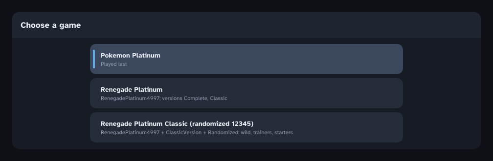

# Features

Everything the Thor build adds beyond the DS game, except the Gear, saves, link play, cheats and the save editor, which have their own pages.

## More than one game (Renegade Platinum)

The app can hold several games side by side, each with its own extracted ROM and its
own saves (the settings are shared). Switch between them in *Settings > Games* (tap a
game twice); the app saves first when the game allows it and restarts into the other
game. When more than one game is installed, a picker also comes up when the app starts
(turn it off there or in *Settings > Games*).

**Adding Renegade Platinum** (Drayano's hack, including the Classic version): unzip the
download, put your Pokemon Platinum (USA) ROM in the same folder (or choose it
afterwards), then *Settings > Games > Add a game > Choose a folder* and pick the folder.
The app tries every patch in it on the ROM and on each other (xdelta's own checksums say
whether a patch was made for what it is applied to, `sim_vcdiff.c`) and shows what it
found:

* the patch that goes on the ROM: `RenegadePlatinum4997.xdelta`, or
  `RenegadePlatinum3541.xdelta` for early ROMs (the one that doesn't match is listed
  under *Not used*);
* the extras that go on top of it, as switches: `SpeedUpPatch`;
* extras that change the same thing as a choice: *ShinyRate: None / 1 4096 / 1 8192*;
* *Versions*: Complete and Classic (below).

*Patch and add* builds the game and extracts it as a new game ("Renegade Platinum").
Extras that change bytes in place are combined from their changes, so any of them can go
together. Folders with several ROMs, a ROM of another
game, archives that still need unzipping and unsupported patch formats (IPS/BPS/UPS) are
handled and explained on the same screen. On Android the folder's patches and Platinum ROMs
are copied in first and deleted again afterwards.

*Choose the files one by one* is still there: the ROM, then each patch in order. An
already patched `.nds` can be added that way (or from a folder) without patches.

**Complete or Classic, per save.** Renegade Platinum's Classic patch only changes the
Pokemon data (170 Pokemon: Classic has the official types and base stats, as in the newer
games with Fairy, and a few different abilities; trainers, wild Pokemon, moves and items
are the same). So it isn't an extra to switch on: the game comes with both versions (the
Classic data is kept next to the game's own, in `versions/`). Starting a new game asks
*Which version?*, Complete or Classic, and the save keeps it: loading a slot plays its
version, and *Settings > Saves* shows it on each slot (change it there only for a save
imported from the other version, since Pokemon you have keep the abilities and stats they
got). The Gear's settings tab shows the version of the save being played.

Already added "Renegade Platinum Classic" (or Complete) on its own? Choose the folder
again: the screen offers *Add them to Renegade Platinum Classic*, which gives that game
the other version and keeps its saves (they stay the version they are) and its extras.
It's then named "Renegade Platinum"; with save sync on, its saves go to that name's
folder from then on.

The hack's new data files (Pokemon, trainers, encounters, text, scripts...) load like
the original's. The few things it changes inside the game's code are read from the
patched ROM at startup (`src/port/rom_patches.c`): map headers, shop stock, Game Corner
prizes, TM moves, icon palettes, shiny odds (1 in 512, or what a ShinyRate patch sets),
every Pokemon obeying, the Fairy type and its type chart, the Fairy move colours and
Pokedex icon, and the Pokemon in Professor Rowan's introduction. The SpeedUp patch's
code changes (instant text and HP bars) are not carried over.

## Randomizer

*Settings > Games > Add a game*: after choosing the ROM (and patches, Renegade Platinum
too), turn on **Randomize it**. A seed (type one with the keypad, or *New seed*) and
these options make the game; the same seed and options make the same game on any device:

* **Wild Pokemon**: each area's Pokemon become others, one for one within the area
  (grass, swarms, day/night, Poke Radar, dual-slot, surfing and fishing), so how often
  each shows up stays the same.
* **Trainers' Pokemon**: levels stay; trainers who chose moves get the new Pokemon's
  latest level-up moves.
* **Starters**: three Pokemon that evolve twice in place of Turtwig, Chimchar and Piplup
  (the starter choice names them); your rival and Dawn/Lucas take the other two the same
  way they would have.
* **Similar strength** (on): each Pokemon becomes one with about the same base stat
  total (within 10%, widened until there's a choice).
* **Keep a type** (off): each Pokemon becomes one sharing a type with it, so gym leaders
  keep their theme; the starters stay Grass, Fire and Water.
* **No legendaries** (on).

It changes the new game's own data files (`src/port/randomizer.c`), so the game, the
Gear's *Area* tab and its Pokedex lookup simply show the randomized Pokemon. Everything
comes from the game's files, so Renegade Platinum's changes (stats, types, learnsets) are
used. The game is named with its seed ("Pokemon Platinum (randomized 12345)") and
*Settings > Games > Save the randomizer's log* saves what became what (spoilers). Gifts
and legendary encounters set by events, the Great Marsh's daily Pokemon, Honey trees and
Trophy Garden aren't randomized.

## Screens

* **Dual-screen devices (AYN Thor):** top screen on the main panel, bottom screen on
  the lower panel. Touch the lower panel to use the touch screen. Touching it does not
  steal controller focus from the game.
* **Single screen:** the normal libntr layouts (vertical, side by side, large screen).
  Touch the bottom screen area directly.

Turn the second display off with *Settings > Display > Bottom screen on the second
display*. *Swap screens* swaps which screen goes on which panel.

**Widescreen (experimental, off by default):** *Settings > Display > Widescreen* fills
the Thor's 16:9 top panel instead of a 4:3 box, on the overworld and in battles, with
the bottom screen on the second display (not swapped):

* **Overworld**: the field camera sees more of the map on the left and right,
  unstretched. Text boxes, menus and the location banner stay 4:3 in the middle. The
  next map blocks load in one frame, so running or cycling sideways doesn't show
  unloaded ground at the edges. Rain, snow, sand, fog and dark caves stay 4:3: their
  weather and darkness are 2D overlays that would only cover the middle. The Poke Radar
  keeps its patches while they are anywhere on the wider screen.
* **Battles**: the backdrop goes on across the whole screen, and the Pokemon, trainers
  and move effects keep their places and shapes (with more room around them when they
  slide in). The text box, HP boxes and the bases stay in the middle.

Menus and other screens stay 4:3.

## GBA slot (Pal Park and dual-slot Pokemon)

On a DS Lite, Platinum looks in the GBA slot. *Settings > GBA slot* puts a game there
without one:

* Choose **Ruby, Sapphire, Emerald, FireRed or LeafGreen**, and **Choose a save**: a
  `.sav` from a GBA emulator (mGBA, VBA, RetroArch, ...; 128 KB). The page shows whose
  save it is, the play time and how many Pokemon are in the party and the PC. Importing
  sets the slot to the save's pair of games (Ruby/Sapphire and FireRed/LeafGreen look
  the same in a save: pick the right one of the two).
* **Dual-slot Pokemon**: with the National Pokedex, some grass gets Pokemon from the
  slot's game (the 4% slots), straight away. The Gear's Area tab lists them under *With
  Emerald in the GBA slot*. This works with no save too.
* **Pal Park**: once you have the National Pokedex the main menu offers *Migrate from
  Emerald* (and so on) to send six Pokemon from the save's PC boxes to Pal Park, as on a
  DS. The GBA game has to be in the same language as this one.
* Platinum works on its own copy of the save: the file you picked never changes.
  Migrating takes the Pokemon out of the copy, as from a cartridge; **Export the save**
  to carry on with it in an emulator.

## Texture packs

*Settings > Display > Texture packs* replaces the game's 3D textures (the overworld,
people, battle Pokemon and effects) with PNGs, the way Dolphin does, at any size: HD
textures, fixes, recolours.

* **Save the game's textures** writes each 3D texture as a PNG the first time it's
  drawn, into `textures/dump/CPUE/` in the app's folder (on Android that's
  `Android/data/org.pokeplatinum.port/files/`, reachable from a computer over USB). The
  name is the texture's size, hashes of its data and of the colours it uses, and its
  format: `tex_64x32_1a2b3c4d_5e6f7a8b_3.png`.
* Edit one (keep its name; any size works) and put it in `textures/load/CPUE/`, in any
  folders, or use **Add a pack** to copy a pack's folder in (its PNGs, with their
  folders). **Look again** picks up files added by hand.
* Menus, text and other 2D graphics aren't textures, so they stay as they are.

## 60 FPS

The DS game runs its logic at 30 frames a second. With *60 FPS* on (the default), the
logic runs at 60 while you are walking around the overworld, which makes walking,
biking and scrolling smooth; the speed fixes keep walking, running, biking, turning,
ledge jumps, sprite animations, water/flower animations and map props at their real
speed. Battles, menus, text, events and everything else switch back to the original
30 so they run at their normal speed. Music always keeps its tempo.

*60 FPS in battles and menus too* (*Settings > Gameplay*, or `60FpsEverywhere=true`)
runs the whole game at 60, which makes everything off the
overworld twice as fast. On the overworld everything keeps the DS speed at 60: walking
and biking, animations, map props, weather (rain, snow, sand, fog), footprints and bike
tracks, the surf blob's bob, reflections, the "!" emotes, door-mat arrows, shadows
changing with the time of day, wandering NPCs' pauses, and the Distortion World's
clouds.

## Speed

* **Instant text** and **instant HP/EXP bars** (*Settings > Gameplay*, both on by
  default): what Renegade Platinum's SpeedUp patch does, for any game. Messages appear
  at once up to where they wait for a button; battle bars jump to their new value.
* **Fast-forward**: hold **R2** (or tap **>>** in the Gear's header to switch it on and
  off). *Settings > Controls* sets the speed (2x to 8x, or Max: as fast as the device
  goes; 4x by default), whether the button works while held or switches it on and off,
  and which button it is. `>> 4x` shows in the top-right corner while it's on. Music
  keeps its normal tempo.
* Battles, menus and other scenes that run at 30 frames a second only draw the frames
  they show (half the drawing). *Settings > Gameplay > Draw every DS frame* draws the
  in-between ones too, should anything flicker.

## Nuzlocke helper

Off by default (*Settings > Gameplay > Nuzlocke*). It keeps the run's books and shows
them on the Gear; it doesn't stop you doing anything:

* Each area's first wild encounter is the one that counts. The battle tab says so
  ("This one counts!"), or what the area's encounter was if it's used up, and the
  Area tab shows the current area's. With the *dupes clause* (on), species you have
  already caught don't count; with the *shiny clause* (on), shinies never count and
  can always be caught.
* Pokemon that faint are dead: dimmed with a cross in Party, and listed with where they
  fell in the Trainer tab, with the run's count of areas caught and missed. *Send
  fainted Pokemon to the PC* (off) takes them out of the party after each battle, as
  long as someone is left.
* The books are kept beside the save slot (`save_slotN.nuzlocke`); *Start a new run*
  clears them.

## Game clock

The game reads the device's clock, as a DS reads its own. *Settings > Gameplay > Clock*
runs it up to 23 hours ahead or behind and up to 6 days ahead, e.g. for night-time
encounters and evolutions, or a weekday's event, without touching the device's clock.
The page shows the day and time the game sees. It is a plain offset: the clock keeps
running and the game does not see it as changed.

## Field moves without HMs

On by default (*Settings > Gameplay > Field moves without HMs*). Once an HM is in your
bag, and you have the badge the game asks for, its move works without teaching it to
anyone: walk up to a tree, rock, boulder, rocky wall, water or waterfall and press A as
usual. A Pokemon in your party that could learn the move does it (the first one that
isn't an Egg if none could), with the usual message and cut-in. Fly (and the others,
where they can be used) shows in that Pokemon's menu in the party screen. Owning the HM
is what keeps the story in order: places the game blocks until you have a move are
opened by the same HM as before.
